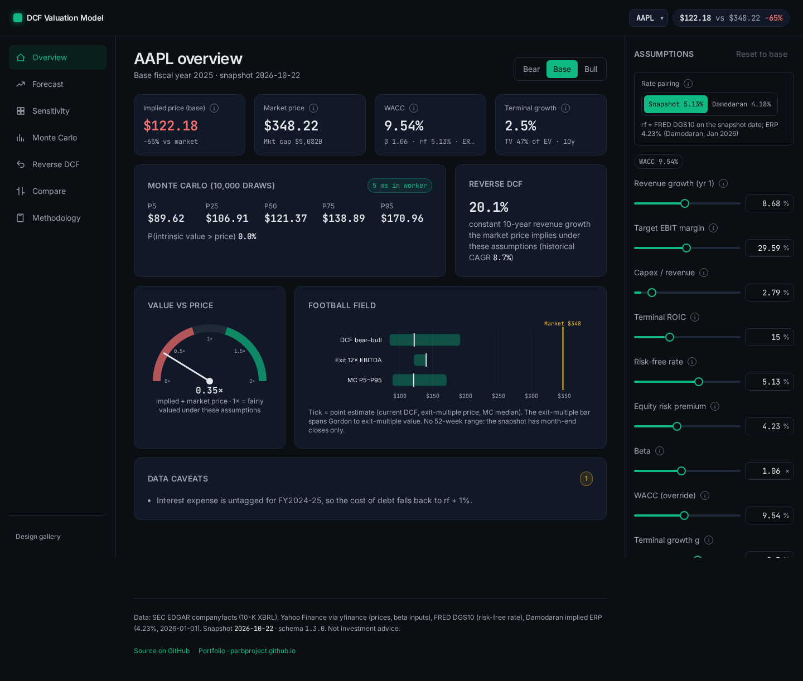
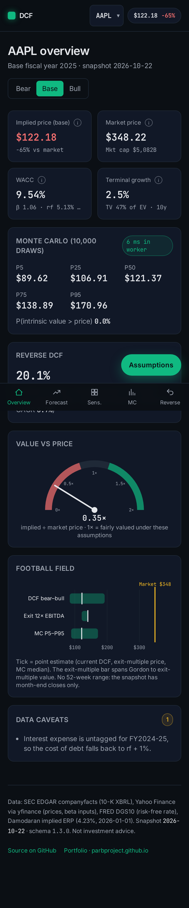
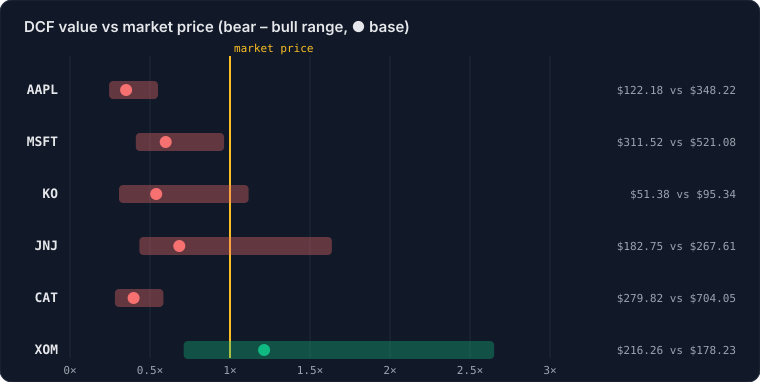
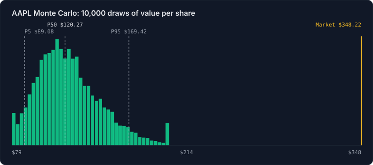
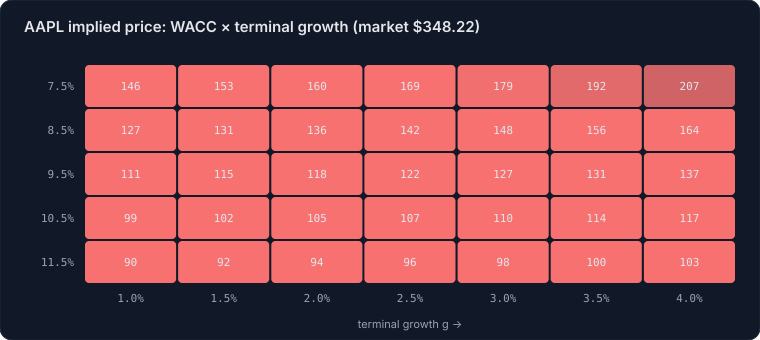
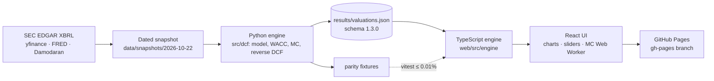

# DCF Valuation Model

[](https://github.com/ParBproject/dcf-valuation-model/actions/workflows/ci.yml)
[](https://parbproject.github.io/dcf-valuation-model/)


**[Live demo →](https://parbproject.github.io/dcf-valuation-model/)**

A reproducible discounted-cash-flow model for six large US companies (AAPL, MSFT, KO, JNJ, CAT,
XOM), built from SEC EDGAR XBRL filings, market data and FRED rates with no hand-typed figures.
A Python engine writes one versioned `results/valuations.json`. A TypeScript port of the same
engine matches it to 0.01% and runs live in the browser, so every assumption is a slider:
sensitivity heatmaps, tornado charts, a 10,000-draw Monte Carlo in a Web Worker, a reverse DCF,
and drill-downs that trace every line item back to its 10-K tag, accession number and filing
date. The app is accessible (axe-clean, full keyboard support), works on mobile, and scores
Lighthouse 91–94 on mobile and 100 on desktop.


<p>
  
  
</p>

> **Not investment advice.** This is a modelling exercise. The values are not buy or sell calls.

## Results

Base case, scenarios, Monte Carlo and reverse DCF from the committed snapshot. The table is
generated from `results/valuations.json`, and `tests/test_readme.py` fails if it drifts.

<!-- results:start -->
| Ticker | Market price | DCF base | Bear – Bull | Upside (base) | WACC | MC P5 – P95 | P(value > price) | Implied 10y growth |
|---|---:|---:|---:|---:|---:|---:|---:|---:|
| AAPL | $348.22 | $122.18 | $85.19 – $191.64 | -65% | 9.54% | $89.08 – $169.42 | 0.0% | 20.1% |
| MSFT | $521.08 | $311.52 | $214.18 – $501.64 | -40% | 9.47% | $224.40 – $439.59 | 1.1% | 15.8% |
| KO | $95.34 | $51.38 | $29.18 – $106.42 | -46% | 7.00% | $31.44 – $86.15 | 2.7% | 12.3% |
| JNJ | $267.61 | $182.75 | $116.02 – $438.04 | -32% | 6.95% | $122.39 – $284.14 | 7.4% | 7.4% |
| CAT | $704.05 | $279.82 | $197.71 – $411.05 | -60% | 11.14% | $206.67 – $375.45 | 0.0% | 20.3% |
| XOM | $178.23 | $216.26 | $126.64 – $472.38 | +21% | 6.82% | $135.26 – $347.86 | 71.9% | 5.6% |

Snapshot 2026-10-22 · rf 5.13% (FRED DGS10, 2026-10-21) · ERP 4.23% (Damodaran, 2026-01-01) · Monte Carlo 10,000 draws · schema 1.3.0. Generated by `scripts/readme_assets.py`.
<!-- results:end -->

The model is well below the market for AAPL, MSFT and CAT. That gap is the main finding, and
it is analysed rather than tuned away: see [Calibration](#calibration-review-m35).

| | |
|---|---|
|  |  |



The charts above are SVGs rendered from the same JSON by `scripts/readme_assets.py`.

## Methodology

- **Free cash flow to the firm:** $\text{FCFF}_t = \text{EBIT}_t(1-\tau) + \text{D\&A}_t - \text{Capex}_t - \Delta\text{NWC}_t$.
  Revenue growth fades linearly from the 6-year CAGR to terminal $g$ over 10 years. EBIT
  margin reverts to the 6-year mean.
- **Discount rate:** $\text{WACC} = \tfrac{E}{V}r_e + \tfrac{D}{V}r_d(1-\tau)$ and
  $r_e = r_f + \beta\,\text{ERP}$. Beta is the 5-year monthly regression against the S&P 500
  with the Blume adjustment ($0.67\beta + 0.33$). $r_d$ is interest over debt, floored at $r_f$.
- **Terminal value:** $\text{TV} = \dfrac{\text{NOPAT}_{T+1}\,(1 - g/\text{ROIC})}{\text{WACC}-g}$
  with ROIC 15%. An exit EV/EBITDA multiple is shown as a cross-check.
- **Equity bridge:** EV − debt (CAT: net of finance receivables) + cash and short-term
  investments, divided by diluted shares.
- **Risk:** a WACC × $g$ grid, a tornado of driver shocks, a 10,000-draw Monte Carlo (seed
  20261022), and a reverse DCF that solves for the growth the price implies.

Full formulas with sources are on the in-app [Methodology page](https://parbproject.github.io/dcf-valuation-model/#/methodology).

**Data sources (snapshot 2026-10-22):**
- SEC EDGAR companyfacts: 10-K XBRL, 6 fiscal years.
- Yahoo Finance via yfinance: prices, and the 5-year monthly closes used for beta.
- FRED DGS10: 5.13% on 2026-10-21.
- Damodaran implied ERP: 4.23%, Jan 2026.

See [SOURCES.md](SOURCES.md).

**Limitations:**
- One snapshot. Prices are month-end closes, so there is no 52-week range.
- The same mechanical driver rules apply to every company: there are no segment models or
  analyst inputs.
- XBRL tagging gaps fall back to documented proxies (listed per ticker in the app's data
  caveats).
- CAT's captive-finance netting is an approximation.
- The Monte Carlo varies only four drivers, and draws them independently.

## Architecture



## Reproduce

```
make install && make results      # snapshot → valuations.json → parity fixtures → README assets
cd web && npm ci && npm run build # sync data, typecheck, build to web/dist
npm test && npx playwright test   # unit + parity; axe, keyboard, mobile, visual regression
npm run deploy                    # publish web/dist to the gh-pages branch (scripts/deploy_pages.sh)
```

`make check` runs ruff and pytest offline against the committed snapshot. `make snapshot`
refreshes the inputs (network; set `SEC_USER_AGENT`).

## Build log

The sections below document each milestone (M1–M7).

## Layout

```
src/dcf/data       loaders: SEC companyfacts, market data, rates
src/dcf/model      DCF math (M2)
src/dcf/analysis   sensitivity / Monte Carlo (later)
data/snapshots     dated raw-input snapshots
results            model outputs
web/               React + TypeScript dashboard (later)
```

## Data layer (M1)

`make snapshot` pulls inputs for AAPL, MSFT, KO, JNJ, CAT and XOM and writes a dated
snapshot to `data/snapshots/<date>/`: one JSON per ticker (6 fiscal years of 10-K figures,
each value tagged with the us-gaap tag, accession number and filing date it came from),
`market.json`, `rates.json` and `manifest.json` (fetch times, sources, coverage).
Tests run fully offline against the committed snapshot. See [SOURCES.md](SOURCES.md).

**SEC User-Agent.** SEC EDGAR asks automated clients for a `"Name email"` User-Agent. The code reads it from the
`SEC_USER_AGENT` environment variable; if that is unset it falls back to the project contact
`Par Bahrae githubproproject@proton.me`. In GitHub Actions the value comes from the `SEC_USER_AGENT` repository secret.
Set your own when you re-fetch: `export SEC_USER_AGENT="Your Name you@example.com"`.

```
make install && make check     # ruff + pytest, offline
make snapshot                  # refresh inputs (network)
```

## Beta (M3)

The snapshot includes `prices.json`: 5 years of monthly adjusted closes for each ticker and
the S&P 500 (^GSPC), fetched 2026-10-22, giving 59 monthly returns. The last month is partial.
The default beta is the **OLS regression beta against the S&P 500 with the Blume adjustment**
(0.67*raw + 0.33). Raw OLS betas are noisy, and low ones such as XOM's 0.17 or JNJ's 0.22
would set the cost of equity barely above the risk-free rate. The raw regression beta and the
yfinance beta are reported alongside it in `results/valuations.json`. Override per ticker with
`beta_method: regression_raw | yfinance` or a fixed `beta:` in `config/<TICKER>.yaml`.

## Analysis (M3)

`results/valuations.json` (schema 1.1.0) is the single file the dashboard reads. Per ticker it
holds the base case, bear/base/bull scenarios (`config/scenarios.yaml`), a WACC ±2pp × g 1–4%
grid, a tornado of driver shocks, a Monte Carlo summary and histogram, and a reverse DCF.

- **Monte Carlo:** 10,000 draws, seed 20261022. growth ~ N(base, 3pp), margin ~ N(base, 2pp),
  WACC ~ N(base, 1pp) floored at rf, g ~ Triangular(1%, base, 3.5%). Draws with g ≥ WACC − 0.5pp
  are rejected and redrawn.
- **Reverse DCF:** the constant revenue growth over the 10-year explicit period at which value
  equals the market price, reported twice: with margins reverting as in the base case, and
  with margins held at the last actual (`implied_growth_margin_held`).

## Calibration review (M3.5)

M3 valued AAPL, MSFT and CAT at roughly a third of their market prices. M3.5 audited why; the
full write-up with before/after tables, a step-by-step gap decomposition and dated benchmarks is
in [docs/calibration.md](docs/calibration.md), and the decomposition is reproducible in
`results/calibration.json` (`python scripts/run_calibration.py`). In short:

- **Errors fixed:** the terminal value carried explicit-period capex − D&A − ΔNWC into
  perpetuity (now reinvestment = g / ROIC, ROIC 15%); short-term investments (e.g. MSFT's
  $55.9B) sat in working capital instead of cash; Cat Financial's receivable-backed debt was
  subtracted as if it were operating debt (now netted against finance receivables).
- **Deliberate choices kept:** a 5.13% risk-free rate with Damodaran's 4.23% ERP, margins
  reverting to the 6-year mean, growth fading to 2.5%, and the 6-year average capex ratio.
- **Bull case** is a fixed, documented set (higher early growth, margins held, 1pp less
  capex, ROIC 25%, WACC −1pp, g +0.5pp), not tuned to prices. It reaches about 96% of the market price for MSFT, exceeds it for
  KO and JNJ, and still falls well short for AAPL (55%) and CAT (58%). Against base WACCs of 9.5–11.1%,
  the market prices of AAPL, MSFT and CAT imply base-case discount rates of about 4.9%, 6.8%
  and 5.8%.

The values are a modelling exercise, not investment advice or buy/sell calls.

## Web app (M4)

`web/` is a Vite + React + TypeScript (strict) app with Tailwind, Radix UI, Framer Motion and
Zustand. Design tokens and rules are in [docs/design.md](docs/design.md). The app reads
`web/public/data/valuations.json`, which `npm run sync-data` copies from `results/`; it is
generated, git-ignored and never hand-edited.

```
cd web && npm ci
npm test            # vitest (store + URL sync)
npm run build       # sync data, typecheck, build (base /dcf-valuation-model/)
npm run shots       # Playwright screenshots + 390px overflow check
npx playwright test # M7: axe, keyboard, mobile/touch, visual regression (see docs/a11y.md)
node scripts/lighthouse.mjs  # with `vite preview --port 4185`; writes docs/lighthouse/summary.json
```

## Live engine (M5)

`web/src/engine/` is a TypeScript port of the Python model: the 10-year fade, margin
reversion, terminal reinvestment g/ROIC, CAPM with the Blume beta, the cost-of-debt floor
and fallback, CAT receivables netting, the EV-to-equity bridge, Gordon growth with the
exit-multiple cross-check, and the reverse-DCF solver. Its inputs are
`tickers[T].engine` in `results/valuations.json` (schema 1.2.0, additive).

- **Parity gate:** `scripts/export_engine_fixtures.py` writes
  `web/src/engine/__fixtures__/parity.json` with base, bear, bull and 5 perturbed sets per
  ticker (including the Damodaran rf pairing). Vitest requires agreement within 0.01%.
- **Monte Carlo** runs in a Web Worker with the same distributions and a seeded PRNG
  (mulberry32 + Box-Muller). The PRNG differs from NumPy, so the match is statistical. Tolerance
  vs Python at 10k draws: P50 ±2%, P25/P75 ±3%, P5/P95 ±5%, P(value>price) ±2pp.
- **Assumptions panel:** a right column on desktop and a slide-up sheet on mobile. It has
  sliders plus numeric inputs, per-field and global reset, diff badges, and the rf/ERP pairing
  toggle. All state is in the URL, e.g. `#/overview?t=KO&s=bull&p=damodaran&beta=0.9`.

Regenerate after any model change: `make valuations && python scripts/export_engine_fixtures.py`, then `cd web && npm test && npm run e2e`.

## Charts, accessibility and performance (M6–M7)

- Charts are custom SVG built on d3-scale/d3-shape. They are themed, work with touch, are
  linked by hover, and each has a visually hidden data table.
- axe reports zero serious or critical violations on every route. Keyboard navigation covers
  everything (heatmap grid, bins, sheets with focus trap), touch targets are at least 44px,
  and safe-area insets are respected.
- Lighthouse scores 91–94 performance on mobile and 100 on desktop, with CLS 0.
- The details are in [docs/a11y.md](docs/a11y.md) and [docs/lighthouse/summary.json](docs/lighthouse/summary.json).

## CI

[](https://github.com/ParBproject/dcf-valuation-model/actions/workflows/ci.yml)

CI is active: [`.github/workflows/ci.yml`](.github/workflows/ci.yml) runs on GitHub Actions
on every push to `main` and on every pull request.

## Deployment

GitHub Pages serves the orphan `gh-pages` branch at `/`, with no workflow file needed.
`npm run deploy` (`scripts/deploy_pages.sh`) builds `web/`, copies `dist/` into a temporary
worktree, adds `.nojekyll`, and force-pushes a single commit to `gh-pages`.

## License
MIT
